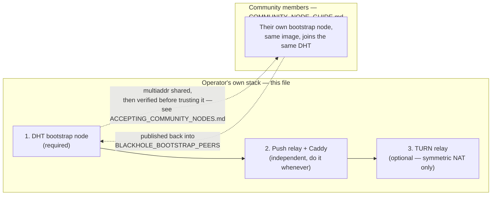

# Deploying Blackhole's infrastructure

Blackhole is deliberately infra-minimal (P2P, no servers hold message
content — see `CLAUDE.md`/`docs/SPEC.md`). Three small pieces still need a
real server, and as of this pass **the code for all three is done and
tested**; what's in this directory is everything needed to actually stand
them up quickly. This guide stays generic for any operator standing up
their own instance — see "Current live deployment" under "After
deploying" for the one this project itself actually runs today (see "What
this does *not* do" below for what a fresh deployment still requires from
you).

| Piece | What it's for | Code | Deploy artifact |
|---|---|---|---|
| DHT bootstrap node | lets daemons find each other at all | `daemon` (`bh-daemon`) | `bootstrap-node/Dockerfile`, `systemd/blackhole-bootstrap-node.service` |
| TURN relay | calls across a symmetric NAT | not this repo's code (coturn) | `docker-compose.yml`'s `coturn` service, `coturn/turnserver.conf.example` |
| Push relay | wakes a suspended daemon | `bh-push-relay` | `push-relay/Dockerfile`, `systemd/blackhole-push-relay.service` |

Everything below assumes you're running these from the repo root (`docker
build`/`docker compose` need the whole Cargo workspace in context — see
`../.dockerignore` for what's excluded).

**Not the platform operator, just want to help the DHT?** You don't need
any of the three pieces below — see `COMMUNITY_NODE_GUIDE.md` instead for
a standalone bootstrap-node-only profile. If you *are* the operator and a
community member just handed you their multiaddr, see
`ACCEPTING_COMMUNITY_NODES.md` before adding it to anything you publish.

## Table of contents

- [What this does not do](#what-this-does-not-do)
- [Order of operations](#order-of-operations)
- [1. DHT bootstrap node](#1-dht-bootstrap-node)
- [2. Push relay](#2-push-relay)
- [3. TURN relay](#3-turn-relay)
- [After deploying](#after-deploying)
- Community-run nodes: [`COMMUNITY_NODE_GUIDE.md`](COMMUNITY_NODE_GUIDE.md) · [`ACCEPTING_COMMUNITY_NODES.md`](ACCEPTING_COMMUNITY_NODES.md)

## What this does *not* do

- Doesn't touch any real cloud account, DNS provider, or domain registrar.
  You provide the host(s), the domain(s), and DNS records.
- Doesn't generate real secrets. `.env.example`/`*.env.example` files have
  placeholder values — replace every one before starting anything
  internet-facing.
- Doesn't add push-relay registration authentication — a real, known,
  *already documented* gap (`docs/THREAT_MODEL.md` §3.12 item 17), not
  fixed by this pass. Doesn't block getting a basic deployment running.
  (Ephemeral, short-lived TURN credentials *are* now available — see this
  file's TURN section below and `docs/THREAT_MODEL.md` §3.15 — opt-in via
  `TURN_AUTH_SECRET` instead of the original static
  `TURN_USERNAME`/`TURN_CREDENTIAL` pair.)

## Order of operations

1. **Bootstrap node first.** Nothing else depends on it, and every other
   daemon (including the push-relay's callers) needs at least one
   reachable bootstrap address to be useful at all.
2. **Push relay next.** Independent of the bootstrap node, but you'll want
   its `https://` URL before testing push registration end-to-end.
3. **TURN last, and optional.** Only needed for calls between two peers
   that are both behind a symmetric NAT — STUN alone (already defaulted
   on, `BLACKHOLE_STUN_SERVERS`) covers ordinary NATs. Skip it if that
   case doesn't matter to you yet.



---

## 1. DHT bootstrap node

A bootstrap node is just an ordinary `daemon` process whose only real job
is staying reachable at a stable address — there's no separate
"bootstrap-only" binary. Two things make that possible that don't apply to
an ordinary end-user daemon (both off by default, both documented in
`docs/THREAT_MODEL.md` §3.5/§3.7):

- `BLACKHOLE_PERSISTENT_NETWORK_IDENTITY=1` — keeps the same libp2p
  `PeerId` (and therefore the same `/p2p/<PeerId>` multiaddr) across
  restarts and crash-respawns. Without this, every restart silently
  invalidates every other node's `BLACKHOLE_BOOTSTRAP_PEERS` entry
  pointing at it.
- `BLACKHOLE_KEYSTORE_BACKEND=file` — a headless container/systemd
  service has no D-Bus Secret Service (gnome-keyring/kwallet) to store
  keys in, unlike a desktop session. This stores key material (including
  the network identity above) as `chmod 600` files under the data
  directory instead — weaker than the OS keychain since the key then sits
  on the same disk as the encrypted database, acceptable here because a
  bootstrap node holds no real contacts/messages, only its own routing
  identity. **Protect the data volume accordingly**: a dedicated volume/
  disk, host-level disk encryption if the provider offers it, and
  filesystem permissions that keep other processes on the host out.

Both are already the defaults baked into `bootstrap-node/Dockerfile` and
`systemd/bootstrap-node.env.example` — you don't need to set them
yourself for the common case.

### Docker

```sh
docker build -f infra/bootstrap-node/Dockerfile -t blackhole-bootstrap-node .
docker volume create blackhole-bootstrap-data
docker run -d --name blackhole-bootstrap-node \
  --restart unless-stopped \
  -p 4001:4001/tcp \
  -v blackhole-bootstrap-data:/var/lib/blackhole/data \
  blackhole-bootstrap-node
```

(or `docker compose -f infra/docker-compose.yml up -d --build
bootstrap-node`, which does the same thing plus a named volume.)

### Bare metal / VM (systemd)

See the install steps at the top of
`systemd/blackhole-bootstrap-node.service`. Use this path if you'd rather
not run Docker, or if your host's Secret Service actually works headlessly
and you want the real OS keychain instead of the file backend (drop
`BLACKHOLE_KEYSTORE_BACKEND=file` from the env file in that case).

### Publishing the bootstrap address

Once it's running, get its `PeerId`:

```sh
docker logs blackhole-bootstrap-node 2>&1 | grep "P2P network stack started"
# tracing::info!(peer_id = %network.peer_id(), ...) — copy the peer_id value
```

The multiaddr every other node's `BLACKHOLE_BOOTSTRAP_PEERS` needs is:

```
/ip4/<this host's public IP>/tcp/4001/p2p/<PeerId from above>
```

Hand that to every daemon you want joining this network (comma-separate
for more than one bootstrap node — do run at least two in production, so
one node's downtime doesn't strand new peers). There's no registry/discovery
mechanism beyond this env var today; distributing the address is on you
(a docs page, a config file shipped with the client, etc.).

**If the container ever needs recreating** (not just restarting — a
`docker rm`, a fresh volume, a new host): the `PeerId` changes, and you
must redistribute the new multiaddr. Restarting the *same* container with
the *same* volume does not have this problem — that's exactly what
`BLACKHOLE_PERSISTENT_NETWORK_IDENTITY` is for.

### Firewall

Open the mapped port (`4001/tcp` above) inbound, publicly. Nothing else —
the daemon's HTTP API binds loopback-only and is never exposed by either
deploy path here.

---

## 2. Push relay

`bh-push-relay` is a small, stateless (in-memory only), rate-limited
HTTP server — see `crates/bh-push-relay/src/lib.rs`'s own module doc for
the full design. It needs to be reachable at a URL every registering
daemon's `POST /push/register` (`bh-api::push`) will call, and every
sending daemon's `wake_recipient_best_effort` will call
`POST {relay_url}/wake/:token` on.

### Why Caddy

`bh-api::push::set_push_registration` accepts `relay_url` as either
`http://` or `https://` — the code doesn't enforce TLS. But the opaque
token would then travel in cleartext to that URL, so any real deployment
should put a TLS-terminating reverse proxy in front rather than exposing
`bh-push-relay` directly. `docker-compose.yml` uses Caddy for this because
it gets a Let's Encrypt certificate automatically with zero manual steps
once DNS points at the host; nginx + certbot works exactly as well if you
already run nginx elsewhere.

### Docker

```sh
cp infra/.env.example infra/.env   # fill in PUSH_RELAY_DOMAIN
# DNS: point PUSH_RELAY_DOMAIN at this host's public IP first —
# Caddy's automatic HTTPS needs that to succeed.
docker compose -f infra/docker-compose.yml up -d --build push-relay caddy
```

### Bare metal / VM (systemd)

See `systemd/blackhole-push-relay.service` — pair it with your own
nginx/Caddy TLS termination in front (not included as a systemd unit here
since most hosts already run one shared reverse proxy for multiple
services, not a dedicated one per app).

### Verifying it end-to-end

```sh
curl -s -X POST https://$PUSH_RELAY_DOMAIN/register \
  -H 'content-type: application/json' \
  -d '{"token":"0123456789abcdef0123456789abcdef"}'
# {"registered":true}

curl -s -X POST https://$PUSH_RELAY_DOMAIN/wake/0123456789abcdef0123456789abcdef
# 202 Accepted (a registered token) or 404 (an unregistered one)
```

Then, on an actual daemon with a live network attached:

```sh
curl -s -X POST http://127.0.0.1:47853/push/register \
  -H "authorization: Bearer $(cat <data-dir>/api-token)" \
  -H 'content-type: application/json' \
  -d "{\"enabled\":true,\"relay_url\":\"https://$PUSH_RELAY_DOMAIN\"}"
```

A `503` here means the daemon couldn't actually reach the relay or
publish its `PushRelayRecord` to the DHT (see `bh-api::push`'s module
doc) — check the relay's reachability and that this daemon has a bootstrap
peer configured (§1) first.

### Firewall

Open `80/tcp` and `443/tcp+udp` (Caddy's automatic HTTPS uses TLS-ALPN-01
by default, which is TLS on 443, plus HTTP-01 fallback on 80). Don't
expose `47900` publicly — only Caddy should reach it, and the
`docker-compose.yml` setup already keeps it as `expose` (Docker-internal
only), not `ports`.

---

## 3. TURN relay

Only needed for calls where both peers are behind a symmetric NAT — the
public STUN default (`BLACKHOLE_STUN_SERVERS`,
`crates/bh-calls/src/transport.rs`) already covers ordinary NATs without
any infrastructure of your own. This code's TURN support is
**configuration only** — pointing at a real coturn instance you run
separately (nothing in this repo implements a TURN server itself) — via
one of two credential schemes.

### Two credential schemes — pick one

- **`TURN_AUTH_SECRET` (recommended).** coturn's `use-auth-secret`/TURN
  REST API scheme. `bh-calls::transport::default_ice_servers` derives a
  fresh, time-limited username/credential pair per call from this shared
  secret (HMAC-SHA1 over an expiry-embedding username, exactly as
  coturn's own REST API spec defines it — the secret itself never goes
  out over the wire). A leaked *derived* credential expires on its own
  (`BLACKHOLE_TURN_CREDENTIAL_TTL_SECS`, default 24h); only the shared
  secret is permanent, and coturn never sees it directly either — it
  recomputes the same HMAC itself to verify.
- **`TURN_USERNAME`/`TURN_CREDENTIAL` (simpler, permanent).** One fixed
  long-term-credential pair (coturn's `lt-cred-mech`). Whatever you set
  is effectively permanent until you change it and restart every daemon —
  a leaked static credential is leaked forever. Kept for setups that
  don't want the extra `TURN_AUTH_SECRET` coordination step.

If both are set, `TURN_AUTH_SECRET` wins on both the coturn side (this
compose file's entrypoint) and the daemon side
(`default_ice_servers`) — consistently, so the two ends never disagree
about which scheme is actually in effect.

### Docker

```sh
cp infra/.env.example infra/.env   # fill in TURN_REALM/TURN_PUBLIC_IP, and either
                                    # TURN_AUTH_SECRET or TURN_USERNAME+TURN_CREDENTIAL
docker compose -f infra/docker-compose.yml up -d coturn
```

Note `network_mode: host` in the compose file — coturn negotiates real UDP
relay ports dynamically across a wide range (`min-port`/`max-port`),
which doesn't work through Docker's normal per-port publishing. This only
works on a real Linux host; on Docker Desktop (macOS/Windows) run coturn
directly on a Linux VM/server instead (see `systemd/` conventions — no
dedicated coturn systemd unit is included here since coturn ships its own
packaged one; use `coturn/turnserver.conf.example` with your distro's
`coturn`/`turnserver` package).

### Wiring it into Blackhole daemons

Set on every daemon that should use this TURN server for calls — matching
whichever scheme you picked above:

```sh
# Option A — TURN_AUTH_SECRET (recommended):
export BLACKHOLE_TURN_SERVERS="turn:turn.example.org:3478"
export BLACKHOLE_TURN_AUTH_SECRET="<the same secret as TURN_AUTH_SECRET above>"
# Optional: export BLACKHOLE_TURN_USERNAME="<a user label>" to embed one in
# the derived username (coturn doesn't require it); export
# BLACKHOLE_TURN_CREDENTIAL_TTL_SECS to override the 24h default.

# Option B — static TURN_USERNAME/TURN_CREDENTIAL:
export BLACKHOLE_TURN_SERVERS="turn:turn.example.org:3478"
export BLACKHOLE_TURN_USERNAME="blackhole"
export BLACKHOLE_TURN_CREDENTIAL="<the same secret as TURN_CREDENTIAL above>"
```

If `BLACKHOLE_TURN_SERVERS` is set but neither scheme is fully configured,
`default_ice_servers()` logs a `tracing::warn!` and skips adding a TURN
entry rather than building a config `webrtc-rs` would reject at
connection time — check daemon logs if calls still fail to connect after
this step.

### Verifying it

For the static-credential scheme, any standard ICE/TURN test tool works
directly against the `turn:`/`turns:` URL and credentials above (e.g.
Mozilla's public "Trickle ICE" tester, or `turnutils_uclient` which ships
with coturn itself: `turnutils_uclient -u blackhole -w <credential>
turn.example.org`). For `TURN_AUTH_SECRET`, generate a username/credential
pair the same way `default_ice_servers()` does before pointing a test tool
at it — e.g. `turnutils_uclient` doesn't speak the REST scheme itself, so
mint a short Python one-liner:
`python3 -c "import hmac,hashlib,base64,time; u=str(int(time.time())+3600); print(u, base64.b64encode(hmac.new(b'<TURN_AUTH_SECRET>', u.encode(), hashlib.sha1).digest()).decode())"`
then pass the printed `username`/`credential` to `turnutils_uclient -u
<username> -w <credential> turn.example.org`.

### Firewall

`3478/tcp+udp` and `5349/tcp+udp` (if using `turns:`/TLS), plus the entire
`min-port`-`max-port` UDP range configured above (`49152-65535` in the
examples here — that's intentionally wide; narrow it in
`turnserver.conf`/the compose `command` if your provider charges per open
port range or if that width raises objections in your environment,
consistently on both ends).

---

## After deploying

- Update `CLAUDE.md`/`docs/THREAT_MODEL.md` with the real facts once
  something is actually live (which domains/addresses, not just "the code
  supports this now") — everywhere else in this repo's history has done
  that as a real deployment landed, not just as code did.
- Consider monitoring/alerting on the bootstrap node's uptime specifically
  — it's the one single point of failure new peers depend on to find
  anyone at all (mitigate by running at least two, per §1 above).

### Current live deployment

Push relay and TURN are up on one AWS Lightsail instance; the bootstrap
node runs there *and* on a second, independent Lightsail instance in a
different region, for the redundancy §1 above recommends:

| Piece | Address | Notes |
|---|---|---|
| Bootstrap node #1 | `/ip4/13.221.175.136/tcp/4001/p2p/12D3KooWKLwn3VqANVSf6QiHRoqSYkH1vf3me6rCxSTz3pXUeGfe` | AWS Lightsail, `us-east-1`. `docker run`-managed, not compose (see below) |
| Bootstrap node #2 | `/ip4/34.215.163.120/tcp/4001/p2p/12D3KooWS5WqhkFTsJgrCfVBdk6FNkVFiHACLh29suxXQUryrxWF` | AWS Lightsail, `us-west-2`, standalone host — only runs the bootstrap node, nothing else. `BLACKHOLE_BOOTSTRAP_PEERS` on each points at the other, so they share one DHT swarm instead of being disjoint islands |
| Push relay | `https://push.vanglaw.org` | On bootstrap-1's host. `docker compose`-managed (push-relay + Caddy); no host port for push-relay itself, only Caddy is internet-facing |
| TURN | `13.221.175.136:3478` (`turn:`), `:5349` (`turns:`, no valid cert yet — no domain assigned to coturn) | On bootstrap-1's host. `docker run`-managed; static long-term credential, not yet switched to the `TURN_AUTH_SECRET` scheme §3.15 added |

Known gaps against this specific deployment, not fixed as part of
standing it up:

- **`bh-push-relay`'s `forward_to_push_provider` is still a stub** — the
  relay is live and reachable over real TLS, but doesn't wake a real
  device (no APNs/FCM wired in yet).
- **Bootstrap nodes and coturn are `docker run`-managed, not
  `docker compose`-managed** — deliberately not migrated, to avoid any
  risk to either bootstrap node's persistent on-disk network identity
  (`BLACKHOLE_PERSISTENT_NETWORK_IDENTITY`) during the switch. Push-relay
  and Caddy *are* compose-managed (`infra/docker-compose.yml`).
- **No monitoring/alerting** is configured for any of the pieces above —
  two bootstrap nodes lowers the odds of *simultaneous* downtime, but
  nothing pages anyone if either goes dark individually.
- **Bootstrap node #2's host is not a `git clone`-free copy** — unlike
  bootstrap-1 (originally set up by copying source), bootstrap-2's
  `/home/ubuntu/blackhole` *is* a real `git clone` of the repo's `origin`,
  tracking whatever `main` was at setup time — a real (if partial) fix for
  the "no clean update path" gap noted elsewhere; bootstrap-1 hasn't been
  converted to match yet.
